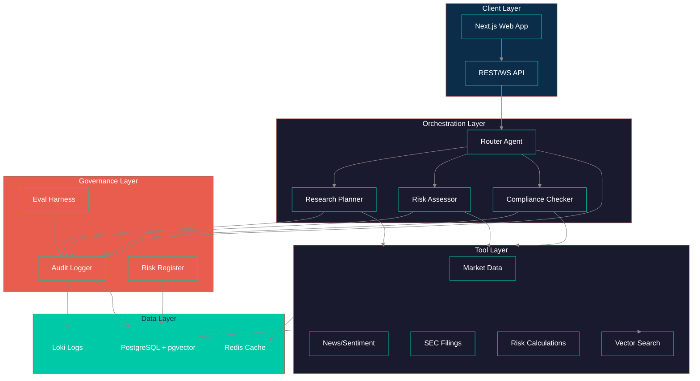
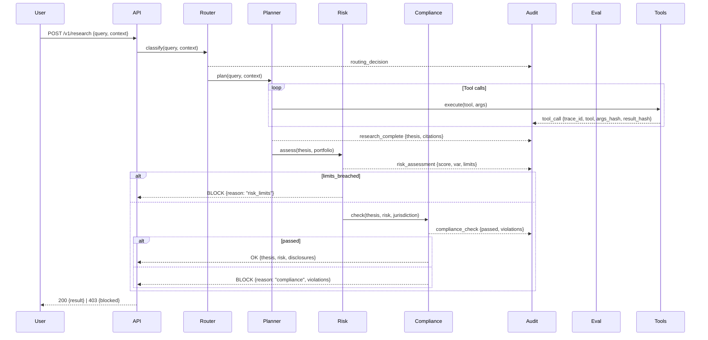

# Novaxis OS / Atlas — Architecture Deep Dive

> This document captures the *why* behind major decisions. Implementation details are in the private repo.

---

## 1. Context & Constraints

**Business context:** Novaxis OS is the orchestration layer for an AI trading advisory system (Atlas). It coordinates specialized agents (research, risk, compliance) to produce audit-ready trade theses for regulated financial services firms.

**Regulatory constraints:**
- Full audit trail for every agent decision (SOX, SEC Rule 17a-4)
- Model explainability for risk assessments (Basel III, MiFID II)
- Data residency: US/EU separation capability
- 7-year audit log retention
- No PII in logs; financial data encrypted at rest

**Technical constraints:**
- Latency budget: <3s end-to-end for research query
- Cost ceiling: <$0.10 per research query (Claude Opus)
- Existing infra: Supabase (PostgreSQL), Vercel, GitHub Actions
- Team: Solo founder + part-time contractors

**Non-goals:**
- Order execution (OMS/EMS integration)
- Real-time market making
- Proprietary alpha generation

---

## 2. High-Level Architecture

---

## 3. Key Design Decisions (ADR Summaries)

| ADR | Decision | Rationale | Trade-offs |
|-----|----------|-----------|------------|
| [001](docs/adr/001-use-nextjs-supabase.md) | Next.js 15 + Supabase over custom Python/FastAPI | Unified frontend/backend, Supabase auth/realtime/pgvector, Vercel deploy | Less control over Python ML stack |
| [002](docs/adr/002-audit-log-design.md) | Structured JSONL + trace IDs + OpenTelemetry-ready | Queryable, correlates with traces, compliance-ready | Storage volume, schema evolution via ADRs |
| [003](docs/adr/003-custom-orchestration.md) | Custom orchestration over LangGraph | Full control over checkpointing, state, governance hooks | More boilerplate, no built-in visualization |
| [004](docs/adr/004-eval-harness.md) | Custom harness + regression + red-team gates | Domain-specific thresholds, blocks bad deploys | Maintenance burden |
| [005](docs/adr/005-bpmn-integration.md) | bpmn-js for visual workflow definition | Domain experts can read/modify flows, executable | Learning curve, limited runtime execution |

---

## 4. Agent / Component Specs

### `Router Agent` — Intent Classification & Routing
- **Trigger:** API request `/v1/research` with query + context
- **Inputs:** `{ query: string, context: { portfolio?, user_id, trace_id } }`
- **Tools:** None (pure classification)
- **Outputs:** `{ route: "research" | "risk" | "compliance" | "clarify", confidence: number, reasoning: string }`
- **Governance:** Emits `routing_decision` audit entry with `trace_id`, `route`, `confidence`, `latency_ms`
- **Failure modes:** Low confidence → `clarify` route; LLM timeout → fallback to keyword router

### `Research Planner` — Query Decomposition & Synthesis
- **Trigger:** Router → `research` route
- **Inputs:** `{ query, context, trace_id }`
- **Tools:** `market_data`, `news_search`, `sec_filings`, `vector_search`, `calculate`
- **Outputs:** `{ thesis: string, citations: [], confidence: number, tools_used: [] }`
- **Governance:** Every tool call logged with `trace_id`, `tool_name`, `args_hash`, `result_hash`, `duration_ms`
- **Failure modes:** Tool failure → partial result + degradation notice; hallucination detection via citation verification

### `Risk Assessor` — Portfolio & Position Risk
- **Trigger:** Router → `risk` route OR post-research gate
- **Inputs:** `{ thesis, portfolio_snapshot, trace_id }`
- **Tools:** `portfolio_load`, `var_calc`, `stress_test`, `concentration_check`
- **Outputs:** `{ risk_score: number, var_95: number, stress_results: {}, limits_breached: [] }`
- **Governance:** `risk_assessment` audit entry; hard gate — blocks if `limits_breached` non-empty
- **Failure modes:** Calculation error → conservative fallback (max risk score)

### `Compliance Checker` — Rule Validation
- **Trigger:** Post-risk, pre-output
- **Inputs:** `{ thesis, risk_assessment, user_jurisdiction, trace_id }`
- **Tools:** `rule_engine` (embedded TypeScript rules)
- **Outputs:** `{ passed: boolean, violations: [], required_disclosures: [] }`
- **Governance:** `compliance_check` audit entry; **hard gate** — `passed: false` blocks output entirely
- **Failure modes:** Rule engine error → fail-closed (block output)

---

## 5. Data Flow & State Management

**State persistence:** Supabase PostgreSQL (conversation history, portfolio snapshots, audit logs) + Redis (session cache, rate limits) + pgvector (research corpus embeddings)  
**Idempotency:** `trace_id` (UUID v7) generated at API entry; all downstream calls carry it; re-runs with same `trace_id` are safe (audit log deduplication)  
**Consistency model:** Read-your-writes for user session; eventual for audit log aggregation

---

## 6. Governance Implementation

### Audit Logging
- **Every LLM call:** `trace_id`, `prompt_hash`, `response_hash`, `latency_ms`, `token_count`, `model_version`, `temperature`
- **Every tool call:** `trace_id`, `tool_name`, `args_hash`, `result_hash`, `duration_ms`, `success`, `error?`
- **Every agent decision:** `trace_id`, `agent_name`, `input_hash`, `output_hash`, `confidence`, `reasoning`
- **Storage:** Loki (structured logs, 30-day hot) + PostgreSQL (audit events, 7-year cold) + S3 (raw payloads, 90-day)

### Eval Harness
| Suite | Frequency | Gate | Threshold |
|-------|-----------|------|-----------|
| Regression | PR + nightly | Block merge | 95% pass |
| Red-team | Weekly | Alert | 0 critical |
| Drift detection | Daily | Alert | >5% shift in risk scores |
| Citation accuracy | PR | Block merge | 90% verified |

### Risk Register (Living Document)
| ID | Risk | Likelihood | Impact | Mitigation | Owner | Status |
|----|------|------------|--------|------------|-------|--------|
| R-01 | PII leakage in logs | Medium | High | Redaction pipeline + schema validation | Jane | Active |
| R-02 | Hallucinated citation in thesis | Low | Critical | Citation verification tool + eval gate | Jane | Monitored |
| R-03 | Market data API failure | Medium | Medium | Multi-provider fallback + cached stale data | Jane | Active |
| R-04 | Compliance rule drift | Low | High | Version-controlled rules + review cycle | Jane | Planned |

---

## 7. Failure Modes & Runbooks

| Scenario | Detection | Mitigation | Runbook |
|----------|-----------|------------|---------|
| LLM API degradation | Latency > p99, error rate > 1% | Fallback to Sonnet, circuit breaker | `runbooks/llm-degradation.md` |
| Audit log backpressure | Loki queue > 10k | Buffer to S3, alert on-call | `runbooks/audit-backpressure.md` |
| Eval regression | Nightly gate fails | Auto-revert last deploy, page | `runbooks/eval-regression.md` |
| Compliance rule error | Rule engine throws | Fail-closed, alert, manual review | `runbooks/compliance-engine-error.md` |

---

## 8. Scaling & Cost Model

| Component | Current Scale | Projected (12mo) | Cost Driver | Optimization |
|-----------|---------------|------------------|-------------|--------------|
| LLM calls | 50k/day | 500k/day | Token volume | Caching, routing to Sonnet for subtasks |
| Vector search | 1M docs | 10M docs | Index size | Partitioning, quantization |
| Audit logs | 10GB/day | 100GB/day | Ingestion + retention | Tiered storage, compression |
| Market data API | 100k calls/day | 1M calls/day | Provider fees | Intelligent caching, batch requests |

---

## 9. Future Work (Roadmap)

- [ ] **Multi-region deploy** for data residency (EU/GDPR)
- [ ] **Formal verification** of critical agent paths (TLA+ / Alloy)
- [ ] **Automated ADR generation** from commit messages + PR titles
- [ ] **Compliance dashboard** for auditors (read-only, real-time)
- [ ] **MCP integration** for standardized tool interfaces
- [ ] **On-device fallback** (llama.cpp/MLX) for privacy mode

---

*Architecture owned by Jane Riveros — questions: `jdriveros232@gmail.com`*