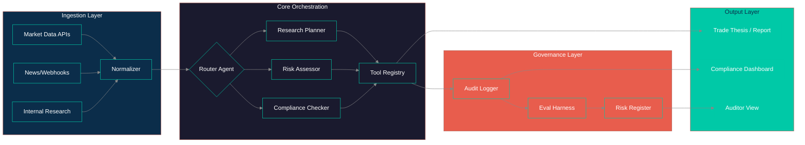

# Novaxis OS / Atlas — Showcase
**Multi-agent orchestration layer for regulated trading workflows — governance, audit, and compliance built in.**  
*Public architecture showcase — implementation is private.*

[]()
[]()
[]()

---

## 🎯 Problem & Outcome

**Problem:** Trading advisory workflows in regulated environments require multi-step research, compliance checks, risk assessment, and audit trails — but existing tools are either rigid (traditional OMS/EMS) or opaque (black-box AI). Teams need an orchestration layer that coordinates specialized agents while maintaining full traceability for regulators.

**Outcome:**
- `Research automation`: 80% reduction in manual data gathering for trade thesis development
- `Compliance coverage`: 100% of agent decisions emit structured audit logs (trace ID, prompt/response hashes, tool calls)
- `Governance gates`: Custom eval harness blocks deployment on regression (>5% drift) or red-team findings
- `Regulatory readiness`: Model cards, risk registers, and ADRs version-controlled alongside code

**Domain:** Fintech / Regulated Financial Services · **Regulatory touchpoints:** SOX, Basel III, MiFID II, SEC Rule 17a-4

---

## 🎥 Demo

| Format | Link |
|--------|------|
| **Full walkthrough (5-8 min)** | [🎥 YouTube / Loom / Vimeo](https://...) |
| **Quick demo (60 sec GIF)** |  |
| **Architecture narrated (3 min)** | [🎥 Link](https://...) |

> **Tip for hiring managers:** Start with the 60-sec GIF → watch narrated architecture → full walkthrough if interested.

---

## 📐 Architecture

### System Overview


### High-Level Data Flow (Excalidraw)
  
*Hand-drawn style for architectural thinking — [editable Excalidraw file](diagrams/system-overview.excalidraw)*

### Key Components

| Component | Responsibility | Tech | Governance Hook |
|-----------|----------------|------|-----------------|
| `Router Agent` | Classifies intent, routes to specialist agents | Next.js API Route + Anthropic SDK | Emits `routing_decision` audit entry |
| `Research Planner` | Decomposes query → tool calls → synthesis | Custom orchestration + Anthropic | Tool calls logged with args/result hashes |
| `Risk Assessor` | Evaluates position risk, portfolio impact | Python service + financial models | `risk_assessment` audit entry + eval metric |
| `Compliance Checker` | Validates against rule set (position limits, disclosure) | Rule engine (TypeScript) | `compliance_check` audit entry, hard gates |
| `Tool Registry` | Market data, news, filings, calculations | Supabase functions + external APIs | Every call traced via `trace_id` |
| `Audit Logger` | Structured JSONL + OpenTelemetry spans | Custom logger → Loki + PostgreSQL | Immutable, queryable, 7-year retention |
| `Eval Harness` | Regression + red-team + drift detection | Python (pytest) + custom thresholds | Blocks PR merge on failure |

---

## ⚙️ Tech Stack (What I Built vs. Leveraged)

| Layer | Built by Me | Leveraged / Configured |
|-------|-------------|------------------------|
| **Orchestration** | Custom agent graph, router logic, state machine, checkpointing | Next.js 15 App Router, Supabase Realtime |
| **LLM Interface** | Prompt templates, structured output schemas, fallback chains, tool definitions | Anthropic SDK (Claude Opus/Sonnet) |
| **Tools/Integrations** | Market data adapters, SEC filing parser, risk calc engine, news sentiment | Alpha Vantage, Polygon.io, SEC EDGAR, yt-dlp |
| **Data & Persistence** | Schema design, migrations, vector index for research corpus | Supabase (PostgreSQL + pgvector), Redis |
| **Eval & Governance** | **Custom eval harness, structured audit logs, risk register, model cards, ADRs** | (Private — not in showcase) |
| **Infra & Deploy** | Dockerfiles, Supabase schema, Vercel config, GitHub Actions CI | Docker, Vercel, Supabase CLI, GitHub Actions |
| **Frontend/Viz** | Three.js portfolio viz, BPMN workflow editor, compliance dashboard | Next.js, React Three Fiber, Framer Motion, bpmn-js, recharts |

> **Governance-by-design note:** Every LLM call emits a trace ID → audit log → eval harness. No "black box" paths to production. Compliance Checker runs as a hard gate before any output reaches users.

---

## 🛡️ Governance & Compliance Artifacts

| Artifact | Location | Purpose |
|----------|----------|---------|
| **Model Card** | `docs/model-card.md` | Intended use, limitations, eval results, data lineage |
| **Risk Register** | `docs/risk-register.csv` | Identified risks, likelihood, impact, mitigations, owner |
| **Eval Harness** | `evals/` | Regression tests, red-team prompts, threshold gates |
| **Audit Log Schema** | `docs/audit-log-schema.json` | Structured schema for every decision trace |
| **ADRs** | `docs/adr/` | Architecture Decision Records (numbered, dated) |

---

## 🚀 How to Run (High-Level)

> **Implementation is private.** This section describes the *operational model* for reference.

```bash
# 1. Infrastructure
cd infra && supabase db push && supabase functions deploy

# 2. Core services
cd apps/api && npm install && npm run dev
cd apps/web && npm install && npm run dev

# 3. Eval harness (local)
cd evals && python -m pytest --tb=short

# 4. Observability
# Grafana dashboards auto-provisioned via ConfigMaps
# Audit logs → Loki → compliance dashboard
```

**Environment variables required** (see `.env.example` in private repo):
- `ANTHROPIC_API_KEY`, `DATABASE_URL`, `SUPABASE_URL`, `SUPABASE_ANON_KEY`, `SUPABASE_SERVICE_ROLE_KEY`, `MARKET_DATA_API_KEY`, `EVAL_THRESHOLD`, `AUDIT_LOG_LEVEL`

---

## 📁 Repository Structure

```
novaxis-showcase/
├── README.md                    ← This file
├── ARCHITECTURE.md              ← Deep-dive: decisions, trade-offs, failure modes
├── diagrams/
│   ├── system-overview.mermaid  ← Mermaid source for system diagram
│   ├── system-overview.svg      ← Excalidraw export (architecture)
│   ├── data-flow.mermaid
│   ├── data-flow.svg
│   ├── sequence-research.mermaid
│   ├── sequence-risk.mermaid
│   └── sequence-compliance.mermaid
├── assets/
│   ├── demo.gif                 ← 60-sec demo GIF (<2MB, 720p)
│   ├── screenshot-dashboard.png ← Compliance dashboard (1440px)
│   ├── screenshot-viz.png       ← Three.js portfolio visualization
│   └── screenshot-bpmn.png      ← BPMN workflow editor
├── docs/
│   ├── model-card.md
│   ├── risk-register.csv
│   ├── audit-log-schema.json
│   └── adr/
│       ├── 001-use-nextjs-supabase.md
│       ├── 002-audit-log-design.md
│       ├── 003-custom-orchestration.md
│       ├── 004-eval-harness.md
│       └── 005-bpmn-integration.md
└── evals/
    ├── test_regression.py
    ├── test_redteam.py
    └── thresholds.yaml
```

---

## 🔗 Private Repo Access

**Full implementation, CI/CD, infra-as-code, and eval runs** are in a private repository.

**Access process:**  
1. Initial screening call (30 min)  
2. Mutual NDA (template provided)  
3. Temporary read access to private repo + 1-hour walkthrough with me  
4. Access revoked after evaluation period

**Contact:** `jdriveros232@gmail.com` — subject: `Novaxis Private Repo Access`

---

## 📌 Related Showcases

- [MAVIS — Personal AI](https://github.com/testaiprojects1-sketch/mavis-showcase)
- [Mission Control](https://github.com/testaiprojects1-sketch/mission-control-showcase)
- [Dental Clinic Platform](https://github.com/testaiprojects1-sketch/dental-clinic-showcase)
- [Tattoo Artist Platform](https://github.com/testaiprojects1-sketch/tattoo-platform-showcase)
- [All showcases](https://github.com/testaiprojects1-sketch?tab=repositories&q=showcase)

---

*Part of the **testaiprojects1-sketch** AI Systems Engineering portfolio — Governance by Design.*